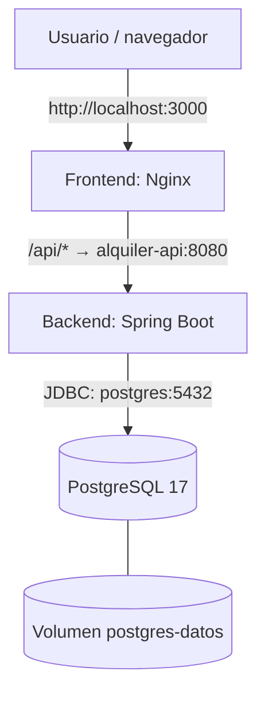

# Sistema de Alquiler de Vehículos

Aplicación web de gestión de alquiler de vehículos, desarrollada con **Java y Spring Boot** para la API REST, **HTML, CSS y JavaScript** para el frontend, y **PostgreSQL 17** para la persistencia. Los tres componentes se ejecutan en contenedores independientes y se administran mediante **Docker Compose**.

> Proyecto de aprendizaje y demostración. La interfaz administrativa no incluye autenticación; no se recomienda exponerla públicamente sin agregar controles de seguridad.

## Funcionalidades

- **Clientes:** consulta, alta, edición y eliminación.
- **Vehículos:** consulta y administración de vehículos, con marca, modelo, categoría, capacidad, disponibilidad y precio diario.
- **Reservas:** registro, consulta y eliminación de reservas; consulta de disponibilidad por rango de fechas.
- **Dashboard:** resumen de vehículos, clientes y reservas.
- **Persistencia:** almacenamiento de los datos en un volumen de PostgreSQL que sobrevive a la recreación de contenedores.

## Tecnologías

| Componente | Tecnología | Servicio Docker Compose |
| --- | --- | --- |
| Frontend | HTML, CSS, JavaScript y Nginx | `frontend` |
| Backend | Java, Spring Boot, Spring Data JPA / Hibernate | `alquiler-api` |
| Base de datos | PostgreSQL 17 | `postgres` |
| Orquestación local | Docker Compose | `compose.yaml` |

## Arquitectura



El navegador obtiene la interfaz desde Nginx. Cuando el JavaScript realiza una petición a `/api/...`, **Nginx la redirige al backend** `alquiler-api:8080`, usando la red interna de Docker Compose. Spring Boot procesa la solicitud y accede a PostgreSQL mediante `postgres:5432`.

### Puertos

| Acceso desde la PC | Puerto del contenedor | Uso |
| --- | --- | --- |
| `http://localhost:3000` | `frontend:80` | Interfaz web |
| `http://localhost:8080` | `alquiler-api:8080` | API REST |
| `127.0.0.1:55432` | `postgres:5432` | Acceso externo a PostgreSQL, por ejemplo desde DBeaver |

> Dentro de Docker, el backend se comunica con la base de datos por `postgres:5432`, **no** por `localhost:55432`. El puerto `55432` solo se publica para acceder desde la computadora anfitriona.

## Estructura del proyecto

```text
alquiler-vehiculos/
├── backend/                  # Aplicación Spring Boot
│   ├── src/
│   ├── pom.xml
│   └── Dockerfile
├── frontend/                 # AutoFlow: interfaz web
│   ├── index.html
│   ├── css/
│   ├── js/
│   ├── nginx.conf
│   └── Dockerfile
├── compose.yaml              # Servicios y red de Docker Compose
├── .env                      # Variables locales: NO subir a Git
└── README.md
```

## Requisitos

- Docker Engine con Docker Compose (por ejemplo, Docker Desktop en Windows).
- Si el Dockerfile del backend copia un JAR ya compilado desde `target/`, también se requiere **Java y Maven** para compilarlo antes de construir la imagen. Puede utilizarse el Maven Wrapper del proyecto, si está disponible.

## Instalación y ejecución

### 1. Obtener el código

```bash
git clone URL_DE_TU_REPOSITORIO.git
cd alquiler-vehiculos
```

Reemplazar la URL por la del repositorio de GitHub. Verificar que existan las carpetas `backend/`, `frontend/` y el archivo `compose.yaml`.

### 2. Configurar las variables de entorno

Crear un archivo **`.env`** en el mismo directorio que `compose.yaml`:

```dotenv
POSTGRES_PASSWORD=CAMBIAR_POR_UNA_CONTRASENA_SEGURA
```

El valor se utiliza para inicializar PostgreSQL y para configurar la conexión del backend. **No subir `.env` a GitHub**. Agregarlo a `.gitignore`.

> Importante: si el volumen de PostgreSQL ya tiene una base de datos inicializada, cambiar `POSTGRES_PASSWORD` en `.env` **no modifica** la contraseña existente del usuario en PostgreSQL.

### 3. Compilar el backend (si corresponde)

Tu Dockerfile usa una compilación multietapa con Maven, podés omitir este paso.

### 4. Levantar los contenedores

Desde la raíz del proyecto:

```bash
docker compose up -d --build
```

Verificar el estado:

```bash
docker compose ps
```

Abrir **http://localhost:3000** en el navegador.

El frontend puede arrancar antes de que la API termine de estar lista; si aparece temporalmente un error `502 Bad Gateway`, esperar unos segundos y actualizar la página.

## Endpoints principales de la API

| Recurso | Operaciones |
| --- | --- |
| `/clientes` | `GET`, `POST` |
| `/clientes/{id}` | `GET`, `PUT`, `DELETE` |
| `/vehiculos` | `GET`, `POST` |
| `/vehiculos/{id}` | `GET`, `PUT`, `DELETE` |
| `/vehiculos/buscar/por-fechas?inicio=AAAA-MM-DD&fin=AAAA-MM-DD` | `GET` |
| `/reservas` | `GET`, `POST` |
| `/reservas/{id}` | `GET`, `DELETE` |

Por ejemplo, la API puede consultarse directamente desde la PC en `http://localhost:8080/vehiculos` o desde el frontend a través de `http://localhost:3000/api/vehiculos`. El frontend usa Nginx como **proxy inverso** para las rutas `/api/`.

## Comandos útiles

```bash
# Iniciar servicios ya creados
docker compose up -d

# Reconstruir imágenes e iniciar
docker compose up -d --build

# Ver estado de los servicios
docker compose ps

# Seguir registros de los contenedores
docker compose logs -f

# Seguir únicamente los registros del backend
docker compose logs -f alquiler-api

# Detener los servicios sin eliminar contenedores
docker compose stop

# Detener y eliminar los contenedores y la red del proyecto
docker compose down
```

**No ejecutar `docker compose down -v` si querés conservar los registros:** esa opción también elimina el volumen de PostgreSQL gestionado por Compose.

## Persistencia de PostgreSQL

La base de datos utiliza el volumen definido en `compose.yaml`:

```yaml
volumes:
  - postgres-datos:/var/lib/postgresql/data
```

Por eso, al detener o recrear los contenedores, los registros siguen disponibles mientras se conserve ese volumen.

**Importante:** el volumen existe en la computadora donde se ejecuta Docker. **No se incluye en la imagen del backend ni se sube a Docker Hub**. Para trasladar los mismos datos a otra PC, es necesario hacer y restaurar un respaldo.

### Generar un respaldo

Desde la raíz del proyecto:

```powershell
docker compose exec -T postgres pg_dump -U alquiler_user -d alquilerdb -F c -f /tmp/alquilerdb.backup
docker cp alquiler-postgres:/tmp/alquilerdb.backup ./alquilerdb.backup
```

Esto genera `alquilerdb.backup` con la estructura y los registros de la base de datos. Guardar el archivo de forma privada porque podría contener información de clientes.

### Restaurar los datos en otra computadora

En una instalación nueva, con la base `alquilerdb` **vacía**:

```powershell
# Iniciar solamente PostgreSQL
docker compose up -d postgres

# Copiar el archivo de respaldo al contenedor
docker cp ./alquilerdb.backup alquiler-postgres:/tmp/alquilerdb.backup

# Restaurar antes de iniciar la API
docker compose exec postgres pg_restore -U alquiler_user -d alquilerdb --no-owner --no-privileges /tmp/alquilerdb.backup

# Iniciar el resto de los servicios
docker compose up -d
```

No restaurar sobre una base que ya tenga las mismas tablas y registros sin preparar previamente una estrategia de restauración: podrían producirse errores o duplicados.

## Publicar las imágenes en Docker Hub

Después de construir las imágenes, iniciar sesión:

```bash
docker login
```

Asignar etiquetas y publicar **las dos imágenes propias**:

```bash
docker tag alquiler-vehiculos-backend:1.0 TU_USUARIO/alquiler-vehiculos-backend:1.0
docker push TU_USUARIO/alquiler-vehiculos-backend:1.0

docker tag alquiler-vehiculos-frontend:1.0 TU_USUARIO/alquiler-vehiculos-frontend:1.0
docker push TU_USUARIO/alquiler-vehiculos-frontend:1.0
```

PostgreSQL utiliza una imagen oficial (`postgres:17`), por lo que no es necesario publicarla en tu cuenta.

Para ejecutar el sistema en otra PC **sin compilar el código**, crear un Compose de despliegue con los mismos servicios, pero reemplazando cada combinación `build` + `image` por la imagen publicada, por ejemplo:

```yaml
alquiler-api:
  image: TU_USUARIO/alquiler-vehiculos-backend:1.0

frontend:
  image: TU_USUARIO/alquiler-vehiculos-frontend:1.0
```

Estas líneas son fragmentos ilustrativos de los servicios: **hay que conservar también** los puertos, las variables de entorno, las dependencias y el servicio PostgreSQL del `compose.yaml` original. En la nueva computadora se necesita además un archivo `.env` propio y, si querés conservar los registros, el respaldo de la base.

## Notas sobre el `compose.yaml`

- `depends_on: postgres: condition: service_healthy` retrasa el inicio de la API hasta que PostgreSQL pase su comprobación de salud.
- `depends_on: - alquiler-api` en el frontend **no garantiza** que Spring Boot ya pueda recibir peticiones. Puede aparecer un `502` breve durante el arranque.
- El volumen `alquiler-datos` declarado con `external: true` **no está montado en ningún servicio** del Compose mostrado. Si ya no se utiliza, puede quitarse esa declaración; el volumen que guarda los registros de PostgreSQL es `postgres-datos`.
- El modo `spring.jpa.hibernate.ddl-auto=update` es práctico en desarrollo, pero para producción se recomiendan migraciones de esquema (por ejemplo, Flyway o Liquibase).
- La interfaz no incorpora autenticación. No publicar directamente el sistema en Internet sin proteger los endpoints y la administración de datos.

## Autoría

Proyecto académico de desarrollo de software y contenerización con Docker.
